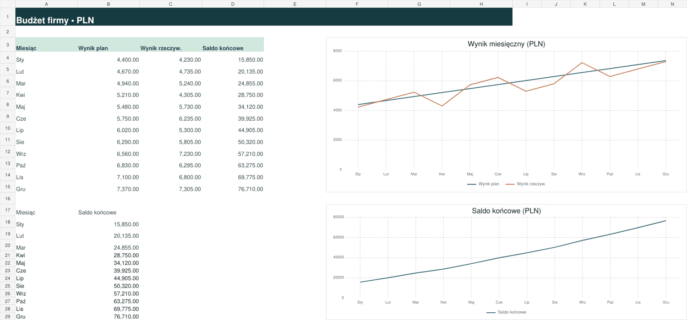

# Budżet firmy

Projekt koncepcyjny – marka fikcyjna

Miesięczny budżet małej firmy w Excelu z porównaniem planu i wykonania, przepływami pieniężnymi i panelem wykresów.

## Overview

A spreadsheet concept for monthly budget tracking, cash-flow planning and financial dashboard commissions. The model uses synthetic sample data in PLN and standard formulas. The Excel edition protects the three output sheets from accidental changes.

## Files

- `exports/budzet-firmy.xlsx`: protected Excel template, no macros.
- `exports/budzet-firmy-sheets-plus.xlsx`: import-ready edition with quarterly reporting.
- `exports/podglad.pdf` and the PNGs: five sheet previews.
- `index.html`: Polish gallery with downloads.

## Editing

Enter monthly values in the blue cells on Dane and update the opening balance in B17. Enter costs and payments as positive values. The Budget view uses revenue and expenses while Cash Flow uses receipts and payments. The formulas are visible in Excel and the formula sheets can be unprotected without a password.

For the Plus edition, upload the XLSX to Google Drive and open it with Google Sheets. Save as Google Sheets, check chart presentation, and configure sheet protection for the people editing the file. See Instrukcja in either workbook for the Polish walkthrough.

## Technology

XLSX, cross-sheet formulas, conditional formatting, charts, worksheet protection, HTML and CSS.
